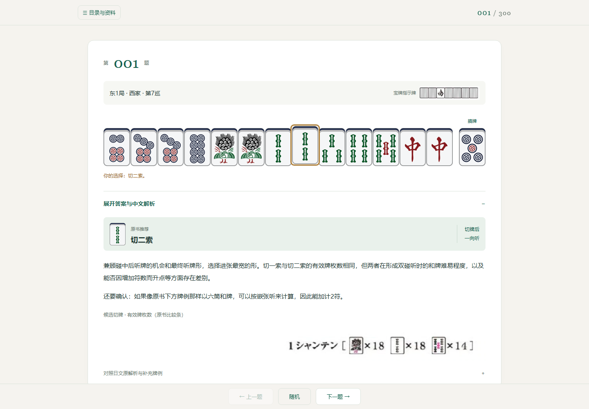
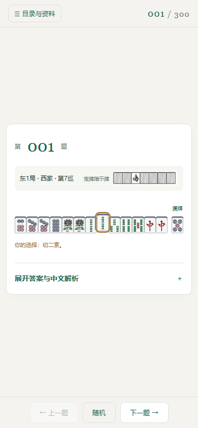

# 何切300问 · 单题网页版

立直麻将「何切」训练器：一屏一道题，点牌作答，展开原书解析看答案，自动记录做题进度、对错与重点题。纯静态站点 + 一个单文件 Python 服务（进度接口），无构建、无数据库、无外部请求。

| 桌面 | 手机 |
| --- | --- |
|  |  |

## 功能

- **单题视图**：一次只显示一道题与折叠的答案，切题即收起；副露题、暗杠题原样呈现
- **作答即提交**：点牌立刻记「已做」并写后端；所选牌与原书推荐同牌记为做对（红五按 5 比较），目录与题库里 ✓ 浅绿、✕ 浅红
- **进度跨设备**：`GET/POST /api/progress`，落盘 `progress.json`；多设备写入是**合并**语义，谁也不冲掉谁
- **重点题**：题号右侧 ☆ 点一下变金色 ★，目录里金色描边
- **题库页** `#bank`：1—300 连续题库，打开自动滚到当前题，答案折叠懒渲染
- **目录分区**：001—090 / 091—180 / 181—240 / 241—300
- **深链与键盘**：`#q001`…`#q300` 直连，刷新与前进后退保留题号；←/→ 切题
- **移动端**：320px 起可用，底栏四键等分不溢出；`dist/icons/` 备 32–512 px 图标与 favicon
- **完全离线**：无 CDN、无外部请求（交付校验记录里 `external_requests: []`）

## 快速开始

```bash
# 起服务（推荐）：静态文件 + 进度接口
python3 serve.py --bind 127.0.0.1 --port 8480
# 打开 http://127.0.0.1:8480/
```

只想看题、不要进度同步，也可以直接双击 `dist/index.html`——资源全走相对路径，能正常渲染；此时没有进度接口，顶栏会显示同步失败。

常用参数：

| 参数 | 说明 |
| --- | --- |
| `--root` | 站点根，默认 `dist/` |
| `--data` | 进度落盘文件，默认仓库根的 `progress.json` |
| `--bind` | 监听地址，可重复；`tailscale` 表示自动取 tailnet 全部地址（v4+v6）；默认 `tailscale` |
| `--port` | 端口，默认 `8480` |

拿不到 tailscale 地址时进程直接退出（退出码 3），交给 systemd 的 `Restart=always` 反复重试，直到 tailnet 就绪。

## 部署

### 静态托管

把 `dist/` 里**全部内容**上传到站点根目录（`index.html`、`reader/`、`images/`、`icons/` 同级），入口是 `index.html`。无需 Node.js、无需编译；放子目录也成立（如 `/mahjong/`），资源全用相对路径，hash 路由不需要 URL 重写。这种托管方式没有后端，进度与星标不会保存。

### 用户级 systemd 服务

```bash
git clone <本仓库地址> ~/mahjong300 && cd ~/mahjong300
install -m644 mahjong300.service ~/.config/systemd/user/
systemctl --user daemon-reload
systemctl --user enable --now mahjong300.service
journalctl --user -u mahjong300.service -f      # 看日志
```

unit 里用 `%h/mahjong300` 定位路径，克隆到别处就同步改那两行。默认 `--bind tailscale`：只监听 tailnet 地址，局域网与公网不可达；想在本地端口开就改 `ExecStart` 里的 `--bind 127.0.0.1`。

不登录也随系统启动需要开启 linger：`loginctl enable-linger $USER`。

## 目录结构

```
.
├── dist/                      # 站点根：上传这个目录即可托管
│   ├── index.html
│   ├── reader/                # reader.js + reader.css + content.js（300 题数据与全书阅读资料）
│   ├── images/                # 题面/解析/图解/牌面，1259 张，按需加载
│   └── icons/                 # 32/48/180/192/512 PNG + favicon.ico
├── serve.py                   # 静态服务 + /api/progress（ThreadingHTTPServer，禁目录列表）
├── make-icons.py              # 由牌面素材生成站点图标（依赖 Pillow）
├── test_progress.py           # 端到端自检（geckodriver + 无头 Firefox）
├── mahjong300.service         # systemd 用户级 unit 模板
├── docs/
│   ├── 部署与阅读说明.md        # 原交付包说明（快照）
│   ├── 开发记录.md              # 迭代与踩坑记录
│   └── 交付校验/                # 文件清单、校验记录、来源记录、预览图
├── LICENSE                    # MIT，仅覆盖代码
└── NOTICE.md                  # 内容版权与来源声明
```

## 进度接口

`GET /api/progress` 读当前状态；`POST /api/progress` 写入，**合并而非覆盖**：

| 字段 | 语义 |
| --- | --- |
| `done` | `{题号: 1}`，取并集 |
| `removed` | `[题号…]`，显式取消「已做」 |
| `stars` | `{题号: 1}`，取并集 |
| `unstared` | `[题号…]`，显式取消星标 |
| `choices` | `{题号: 选项下标}`，以本次写入为准 |
| `current` | 当前题号，以本次写入为准 |

题号限定 1—300、选项下标限定 0—20，越界项静默丢弃；请求体超过 200 KB 直接 400。落盘用临时文件 + `fsync` + `os.replace` 原子替换，进程内加锁串行化。响应示例：

```json
{"ok": true, "updated": "2026-11-10T10:53:03+08:00", "done": {"1": 1}, "stars": {}, "choices": {"1": 7}, "current": 2}
```

**没有鉴权**——单人自用设计，权限靠网络边界（tailnet / 内网）兜底，不要直接把端口暴露到公网。

## 自检

```bash
python3 test_progress.py     # 依赖 geckodriver + 无头 Firefox，跑完打印 ALL CHECKS PASSED
```

脚本会另起一个 `serve.py`（独立端口 8499、独立数据文件 `/tmp/mj-test-progress.json`），不动线上 `progress.json`。检查项：三个独立浏览器会话（等同三台设备）的进度写入与取消、旧 localStorage 一次性并入、题库 300 项、目录分区 90/90/60/60、`#bank` 直链。

服务侧另按 `docs/开发记录.md` 的手工项验证：首页/reader/图片 200、404、目录列表 403、局域网不可达、`kill -9` 后自愈。

## 换图标

```bash
python3 make-icons.py                  # 東（默认 1z）
python3 make-icons.py --tile 7z        # 中
python3 make-icons.py --tile 5z --pad 0  # 白，铺满无留白
```

可用牌面见 `dist/images/tiles/`。改完把 `dist/index.html` 里 icon 链接的 `?v=` 提高一档，否则浏览器继续用旧图标。

## 版权与许可

- **代码**（`serve.py`、`make-icons.py`、`test_progress.py`、`dist/reader/reader.js`、`dist/reader/reader.css`、`dist/index.html`）：MIT，见 `LICENSE`。
- **题目内容**（`dist/images/` 的题面与解析图、`dist/reader/content.js` 里的译文与阅读资料）：版权归原书作者与出版方所有，**不在 MIT 范围内**。本仓库收录仅供个人学习、研究与本地自测，不得商用；权利人如不认可，提 issue 即刻移除。详见 `NOTICE.md`。
- **牌面素材** `dist/images/tiles/*.png`：取自 [riichimahjongtrainer/riichimahjongtrainer](https://github.com/riichimahjongtrainer/riichimahjongtrainer)（commit `ed5a80b`），见 `docs/交付校验/来源记录.json`。

本仓库约 53 MB，绝大部分是题面图；`progress.json` 是本机做题数据，已被 `.gitignore` 排除。
